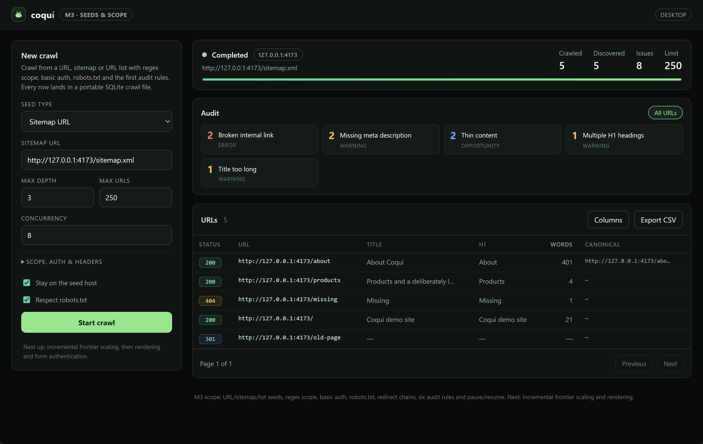

# Coqui

**A modern, open-source reimplementation of Screaming Frog SEO Spider — Rust engine, Next.js workspace.**

Named after the *coquí*, the tiny frog native to Puerto Rico whose call is everywhere on the island and nowhere else.



> Coqui is an independent clean-room project. It is not affiliated with, endorsed by, or derived from Screaming Frog code or assets. "Screaming Frog" is a trademark of its owner.

## Status

**Pre-1.0 — parity breadth and release engineering** (referred to as **M6** in the working notes). There is no tagged release yet.

Working end to end today:

- **Crawl:** URL, sitemap and list seeds; regex scope; robots.txt; redirect chains; basic auth, headers, cookies and proxy; per-host delay and max-RPS pacing; 429 retry; pause/resume with checkpoints; crawl profiles; completion webhooks.
- **Render:** headless Chromium over CDP; screenshots; console and network diagnostics; axe-core accessibility; Web Vitals; custom JavaScript; authenticated rendering; asset blocking and wait strategies.
- **Audit:** 50 static rules plus one `axe_*` rule per accessibility violation; suppression with reasons, expiry and actor attribution; severity overrides; audit log; issue settings import/export/diff.
- **Workspace (desktop):** result grid with filters, sorting and saved views; crawl history, profiles and schedules; crawl comparison; overview cards, segments, duplicates and throughput timeline; issue drill-down; URL inspector with headers, axe, links, images, screenshot and raw/rendered source.
- **Exports and reports:** 15 export families plus `all`; CSV/XLSX; sitemaps (single, split gzip, image); 15 HTML/PDF report kinds plus batch generation and comparison CSVs.
- **Automation:** CLI (`crawl`, `resume`, `report`, `reports`, `export`, `exports`, `extractions`, `sitemap`, `schedule`, `serve`, `overview`, `prune`, `doctor`, `bench`, `browser`, `update`, `import sf`, `issue-settings`, `mcp`); HTTP API (read endpoints plus `POST /crawls`, optional bearer token); stdio MCP server; interval scheduler.
- **Parity and release engineering:** Screaming Frog `.dbseospider` import; golden-fixture parity harness with a CI gate; storage benchmarks with budgets and nightly regression gating; OS/arch-qualified release assets with checksums; reproducible builds; bundled Node + Lighthouse sidecars; checksummed Chrome for Testing installer; self-update.

Not implemented yet: third-party integrations (Search Console, GA4, PageSpeed Insights, Ahrefs, Majestic, Moz), AI providers and embeddings, the reference product's 34-tab workspace and 97-report catalogue, locales, Postgres/server mode, projects/workspace lifecycle, SERP and scripted-login modes, bundled Chromium, and a signed release. See [status](docs/status.md) for the current snapshot and [handover](docs/handover.md) for what comes next.

## What Coqui will be

The target is behavioural and data parity with Screaming Frog SEO Spider 25.1: crawl, render, audit, analyse, deliver and automate. The full surface is measured in the [feature inventory](docs/feature-inventory.md):

- **Crawl** — HTTP/2 crawler with robots handling, URL normalisation, auth, scoping, pacing, pause/resume and portable crawl files.
- **Render** — headless Chromium over CDP: rendered DOM, screenshots, JS/CSS coverage, console diagnostics.
- **Audit** — SEO extraction, content and duplicate analysis, structured data, security, accessibility (axe), Lighthouse/PageSpeed, custom extraction/search/JS.
- **Analyse** — 34-tab results workspace, filtering, detail panes, dashboard, segments, graphs and word clouds.
- **Deliver** — 97 report types, bulk exports (CSV/XLSX/Sheets), XML/image sitemaps, email notifications.
- **Automate** — CLI, scheduler, MCP server for AI clients, headless container operation.
- **Enrich** — Search Console, GA4, PageSpeed, Ahrefs, Majestic, Moz, and any OpenAI/Anthropic/Gemini/Ollama model.

## Architecture

Tauri is the application shell. The Rust workspace runs in-process and owns crawling, storage and analysis; the Next.js UI is statically exported and rendered in the system WebView (WebView2 / WKWebView / WebKitGTK) from one codebase. The same crates back the CLI, the HTTP API and the stdio MCP server.

```
┌──────────────────────── Tauri 2 shell ─────────────────────────┐
│  apps/web — Next.js 16 static export (React 19)                │
│      ▲ IPC commands / events ▼                                 │
│  src-tauri — commands, state, lifecycle                        │
└──────────────────────────────┬─────────────────────────────────┘
                               │
  coqui-core   domain, URL identity, config, issue taxonomy
  coqui-store  SQLite schema, migrations, paged queries
  coqui-crawl  frontier, HTTP, robots, seeds, extraction
  coqui-audit  rule engine, suppressions, overrides
  coqui-render Chromium/CDP, screenshots, axe, vitals
  coqui-lighthouse  Node/Lighthouse runner
  coqui-report HTML/PDF reports, comparison
                               │
  same crates: coqui-cli · coqui-api (axum) · MCP server (stdio)
```

- **Shell:** Tauri 2 (Rust), WebView2/WKWebView/WebKitGTK, installers for Windows/macOS/Linux.
- **Backend:** Rust 2024, tokio, reqwest, scraper, rusqlite (SQLite), Chromium over CDP, Lighthouse through a Node sidecar.
- **Frontend:** Next.js 16 App Router with `output: 'export'`, React 19, hand-written CSS. The earlier TanStack/Radix/Tailwind/Monaco/d3 plan was not adopted; the workspace is a single client component today.
- **Data:** one portable SQLite crawl file per crawl (schema v35). Postgres is a planned server-mode option, not a requirement.

## Repository layout

```
apps/web              Next.js static-export workspace
crates/               Rust workspace (core, store, crawl, audit, render,
                      lighthouse, report, api, cli)
src-tauri/            Tauri shell: commands, state, lifecycle, sidecars
docs/                 inventory, plan, evidence, references, validation
tools/plan/           backlog data and generators (single source of truth)
tools/parity/         Screaming Frog import/compare harness and fixtures
tools/bench/          storage benchmark, budgets and regression comparison
tools/fixture/        local crawl fixtures
tools/sidecar/        Node + Lighthouse fetch script
tools/docs/           documentation consistency check
```

## Documentation

- [Feature inventory](docs/feature-inventory.md) — what the reference product does, measured (reference target, not Coqui status)
- [Development plan](docs/development-plan.md) — the original architecture, phases, estimates and risks
- [Reverse-engineering notes](docs/reverse-engineering.md) — evidence and limitations
- [Status](docs/status.md) — current milestone snapshot and known gaps
- [Handover](docs/handover.md) — current state, parity workflow and next steps
- [Dev setup](docs/dev-setup.md) — run the desktop shell, tests and builds
- [CLI reference](docs/cli.md) — every command and flag
- [HTTP API](docs/api.md) — server mode, auth, exports/reports, starting crawls
- [Reports](docs/reports.md) — report catalogue, PDF, batch and comparison outputs
- [Exports reference](docs/exports.md) — export families, filename tokens, skip-empty
- [Audit rules](docs/audit-rules.md) — every rule, severity and threshold
- [Rendering](docs/rendering.md) — Chromium/CDP, screenshots, vitals, axe
- [Lighthouse](docs/lighthouse.md) — sidecars, fallbacks and sampling
- [Packaging](docs/packaging.md) — installers, sidecars, release jobs
- [Install](docs/install.md) — binaries, Docker Compose, browser and updates
- [Release](docs/release.md) — assets, checksums, reproducible builds
- [Versioning](docs/versioning.md) — SemVer, schema and API compatibility
- [Signing](docs/signing.md) — Windows/macOS signing runbook (certificates pending)
- [CI operation](docs/ci.md) — workflows, artifacts, API smoke tests
- [Benchmarks](docs/benchmarks.md) — 10k/50k/1M measurements and budgets
- [Changelog](CHANGELOG.md) — release notes
- [Regression validation](docs/validation/2026-11-20-regression.md) — post-change real-site crawl
- [Rendered vitals validation](docs/validation/2026-11-21-rendered-vitals.md) — rendered crawl with axe and vitals
- [First parity diff](docs/validation/2026-11-21-first-parity-diff.md) — Screaming Frog 25.1 database comparison
- [Parity workflow](docs/reference/parity-workflow.md) — reference crawl export comparison
- [Parity matrix](docs/reference/parity-matrix.csv) — planning snapshot of every feature, phase, size and priority (the [project board](https://github.com/users/adamgreenwell/projects/16/views/1?layout_template=board) is the live source)
- [Wiki](https://github.com/adamgreenwell/coqui/wiki) — architecture and feature notes

## Backlog

As of 2026-11-21: **86 issues** (12 epics + 74 features), **74 open** and **12 closed**. Issues are split across five milestones:

| Milestone | Epics | Features |
| --- | --- | --- |
| Phase 0 — Foundations | 5 | 16 |
| Phase 1 — Core parity | 4 | 20 |
| Phase 2 — Advanced audit and UX | 0 | 23 |
| Phase 3 — Integrations and AI | 2 | 11 |
| Phase 4 — Hardening and 1.0 | 1 | 4 |

The original plan data lists 73 features; R-08 (challenge/WAF handling) was added during implementation, so the board is canonical.

Pick an issue from the [board](https://github.com/users/adamgreenwell/projects/16/views/1?layout_template=board), comment to claim it, and open a PR against the phase milestone. Every feature issue lists its acceptance criteria and the parity evidence behind it.

## Checks

```bash
cargo fmt --all --check
cargo test --workspace        # 112 pass, 5 browser-dependent render tests ignored
npm run build:web             # Next.js static export
node tools/docs/check.mjs     # documentation/code consistency
node tools/parity/compare-exports.mjs --reference tools/parity/fixtures/reference \
  --coqui tools/parity/fixtures/coqui --tolerance tools/parity/fixtures/tolerance.json \
  --require-counterparts --max-mismatches 0
```

## Reproducing the inventory

The inventory is generated from evidence, not hand-maintained:

```bash
node tools/plan/build.mjs
```

This regenerates `docs/feature-inventory.md`, `docs/reference/*.csv` and the issue payloads from `tools/plan/*.mjs`. It needs the local reverse-engineering artifacts under `research/` (not committed) to reproduce the original counts; without them it still writes the derived files from the plan data.

## License

To be decided by the project owner before the first code release (MIT or Apache-2.0 are the candidates). Until then, no license is granted for reuse and no `LICENSE` file exists.
